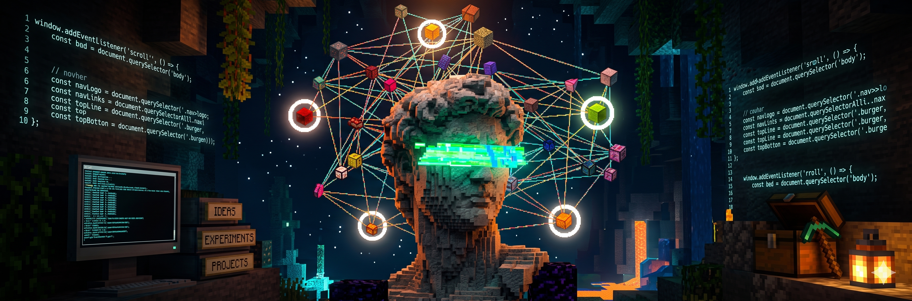

 

  

<h1 align="center">👋 Hi, I'm Arfat Khan</h1>

<h3 align="center">AI/ML Engineer | LLM Systems | Applied AI Infrastructure</h3>

  Building intelligent ML systems, LLM applications, and reliable software through problem-driven engineering.

  📍 Mumbai, India ·
  <a href="https://github.com/cypher-aa">GitHub</a> ·
  <a href="https://www.linkedin.com/in/arfat-khan-0211a3265/">LinkedIn</a> ·
  <a href="mailto:arfathkhan787@gmail.com">Email</a>

---

## 🚀 Flagship Projects

### 🧠 1. AutoML Studio ULTRA
**Intelligent Automated Machine Learning Platform**

**Problem:** Poor dataset quality and fragmented ML workflows make it difficult to develop and evaluate reliable predictive models.

**Solution:** Built an AutoML platform organized around seven intelligence systems, including Dataset Intelligence, Data Defect Investigator, Data Improvement Lab, and Reliable AutoML Engine.

- **Dataset Intelligence:** Analyze datasets and surface potential quality issues before model training.
- **Data Defect Investigation:** Investigate data-quality problems that may undermine downstream model performance.
- **Data Improvement:** Structure preprocessing and data-improvement workflows.
- **Reliable AutoML:** Support model development, evaluation, and evidence-based model comparison.

**Tech Stack:** Python, TypeScript, React, Vite, Flask, Express.js, SQLite, Scikit-learn — verify against the final repository.

🔗 [GitHub Repository](https://github.com/cypher-aa/automl-studio) · [Live Demo](https://auto-ml-ultra-final.onrender.com/)

---

### 🤖 2. HyperMind AI
**Multi-Assistant LLM Workspace**

**Problem:** AI interactions and knowledge workflows can become fragmented across separate tools and assistants.

**Solution:** Built a full-stack AI workspace integrating Gemini-powered capabilities through a modular application and backend architecture.

- **LLM Integration:** Integrate Gemini capabilities through dedicated AI integration modules.
- **RAG Infrastructure:** Organize retrieval-related functionality in dedicated modules for knowledge-grounded AI workflows.
- **Agent Runtime:** Maintain a dedicated runtime layer for extending AI execution capabilities.
- **Full-Stack Architecture:** Connect a React/TypeScript/Vite frontend to an Express 5 backend with PostgreSQL persistence using Drizzle ORM.

**Tech Stack:** React, TypeScript, Vite, Node.js, Express 5, PostgreSQL, Drizzle ORM, Gemini API.

🔗 [GitHub Repository](https://github.com/cypher-aa/Hypermind-AI) . [Live Demo](https://hypermind-ai.onrender.com/)

---

### 🛡️ 3. ForgeAI
**Secure Software Engineering & Reliability**

**Problem:** Weak tenant isolation, incorrect database policies, and unsafe recovery procedures can compromise data confidentiality and integrity.

**Solution:** Focused on database security, tenant-aware access controls, migration safety, and automated verification of critical invariants.

- **Tenant Isolation:** Verify that organization-level access controls preserve data boundaries.
- **Row-Level Security:** Inspect and validate RLS policy behavior against tenant-aware authorization requirements.
- **Migration & Recovery Safety:** Verify migration, rollback, and recovery safeguards to help prevent security regressions.
- **Regression Verification:** Test critical authorization and data-integrity requirements.

**Tech Stack:** TypeScript, Prisma, SQL, Row-Level Security, automated regression testing — verify the complete stack against the repository.

🔗 [GitHub Repository](https://github.com/cypher-aa/FORGE-AI-2) . [Live Demo](https://forgeai-i0vz.onrender.com/)

---

## 🛠️ Technical Skills

### 💻 Programming Languages

---

### 🤖 Machine Learning & Data Science

**Concepts:** Data preprocessing, feature engineering, supervised learning, classification, regression, model evaluation.

---

### 🧠 Deep Learning & LLM Engineering

**Concepts:** Neural networks, backpropagation, gradient descent, Transformer architecture, embeddings, Retrieval-Augmented Generation (RAG), prompt engineering, AI agent architecture.

---

### ⚙️ Backend & Databases

---

### 🎨 Frontend & Developer Tools

---

## 🎯 Engineering Approach

- **Problem-first development:** Identify meaningful engineering problems before selecting technologies.
- **Evidence-based evaluation:** Validate systems through experiments, automated tests, and measurable outcomes.
- **Modular architecture:** Build maintainable components that can be tested and extended.
- **Reliability and security:** Prioritize correctness, data integrity, access control, and failure handling.

---

## 📫 Connect With Me

  💼 <a href="https://www.linkedin.com/in/arfat-khan-0211a3265/">LinkedIn</a> ·
  🐙 <a href="https://github.com/cypher-aa">GitHub</a> ·
  📧 <a href="mailto:arfathkhan787@gmail.com">arfathkhan787@gmail.com</a>

---

  <i>Building practical AI systems through thoughtful engineering and measurable results.</i>

